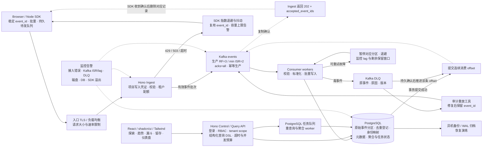
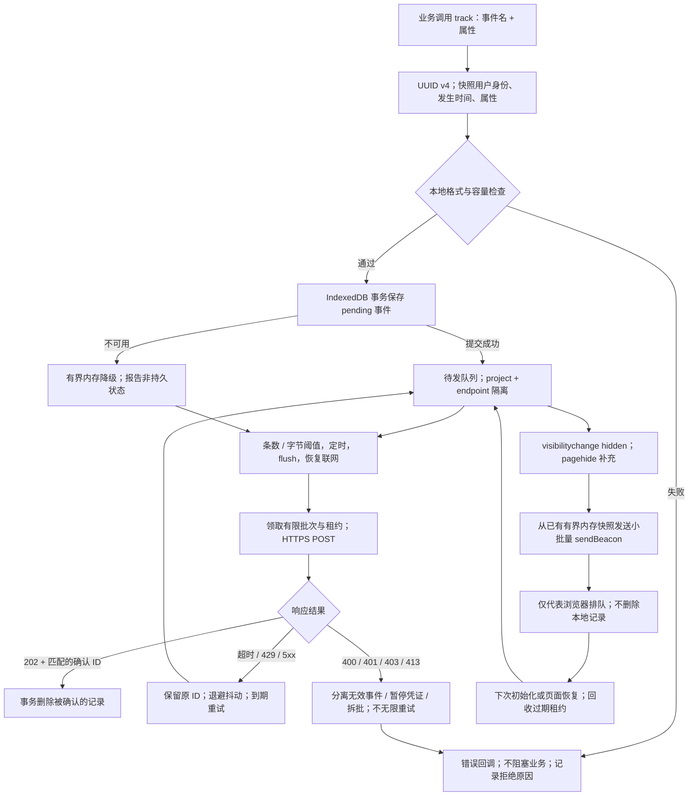
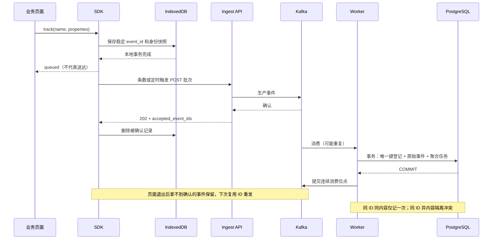

# 架构 v2：SDK 可靠投递与幂等消费

更新日期：2026-10-22。基础方案已确认，本版补齐 SDK 本地队列、批量上报、页面退出补发和消费去重；产品需求与验收见 [PRD](PRD.md)。本版 Mermaid 和文字是实施依据。

历史图片见 [v1 视觉草图](architecture-v1-visual-draft.png)，由内置 imagegen 根据 [提示词](architecture-image-prompt.txt) 生成，未包含本版 SDK 流程。图片存在两处绘图偏差：202 返回线应从 Kafka 确认经 Ingest 返回 SDK，而不是从 Consumer 返回；Kafka 按用户键哈希分区，不按时间分区，时间分区属于 PostgreSQL。图片仅留作历史参考，不得单独作为实施规格。

## 数据接入与分析流程

## 确认、重复与顺序

- HTTP 202 表示有效批次已被 Kafka 确认，不表示分析结果已更新。校验失败整批返回 400 并提供错误定位；鉴权失败 401/403；限流 429；持久接收无法确认返回 503 或超时。超时属于结果未知，使用相同 ID 重试。
- SDK 生成稳定 event_id；浏览器用 IndexedDB（受浏览器配额、清理、关闭时机限制），Node SDK 提供持久 outbox 适配器。仅内存或 sendBeacon 不构成持久送达保证。浏览器写入凭证可公开，仅允许写入，不能访问查询或管理 API。
- 持久接收后的传输采用至少一次投递，浏览器到接入 API 为尽力送达，不能将客户端未持久保存或从未送达的事件纳入零丢失承诺。PostgreSQL 同一事务内登记 UNIQUE(project_id,event_id) 去重键并写入原始事件，仅对新增事件产生聚合影响；成功提交数据库事务后才提交连续消费 offset。分区原始表的唯一约束必须包含分区键，因此跨分区去重依靠独立登记表，不能仅依赖分区表约束。
- 去重登记保留期至少覆盖所有允许重试/重放窗口；过期重放需走专门对账流程。原始事件、去重登记与聚合的删除/保留策略必须一致设计。
- 按 project_id + distinct_id 哈希分区，只有分区内有序；event_time 与 received_at 均保留，分析按事件时间处理迟到数据。身份合并与匿名转登录口径在 PRD 确定。
- DLQ 成功写入后才能越过毒事件；DLQ 不可用则暂停，不静默跳过。DLQ 有明确保留期与告警，重放保留事件 ID，避免重复计数。

## SDK 本地队列与发送流程

- event_id 在事件产生时通过安全随机源生成 UUID v4；每次新操作生成新 ID，重试、关闭补发、Kafka 重投和 DLQ 重放保持原 ID。distinct_id 标识用户，event_name 标识行为，三者互不替代；身份和属性在 track 时快照，后续登录不得重写旧记录。
- track 返回本地入队结果，不等于服务端接收成功。IndexedDB 写入异步执行；只有事务完成后才报告持久入队，不能等批量阈值才开始保存。浏览器突然退出可能打断该事务。
- 默认发送条件、容量、过期与错误语义详见 PRD。SDK 不全量扫描数据库、不无限并发；按索引分批领取。内存降级和持久队列使用相同发送调度器，但内存事件在关闭后无法恢复。
- 多标签页用 IndexedDB 原子租约领取记录，租约过期可回收，网络请求期间不持有数据库事务；不保证退出补发与正常发送绝不重叠，服务端必须去重。
- 页面 hidden 时尽力发送，pagehide 作补充；不依赖 unload/beforeunload，不阻塞导航。提前维护小批量内存快照，不能等到关闭时才读取全部 IndexedDB。生命周期触发与正常发送可以重复，重复安全优先于漏报。
- sendBeacon 返回 true 不代表 HTTP 202，无法读取服务器确认，持久记录继续保留。返回 false 同样保留；页面再次可见或下次加载时用普通 fetch 发送以取得确认。页面关闭后没有一个保证继续执行的 SDK worker；Service Worker / Background Sync 非首版依赖。
- 首版统一使用可被普通 fetch 和 sendBeacon 发送的 UTF-8 text/plain JSON 信封，公开项目写入凭证位于信封中，便于退出路径避免自定义请求头及不必要预检。接入端显式解析、校验 Origin 与请求体；普通 fetch 返回精确 CORS 头，不携带站点 Cookie。公开写入凭证和 Origin 白名单均不能替代限流或证明事件真实来源。
- 202 只在批次所有事件获 Kafka 确认后返回 accepted_event_ids；结果未知时整批重试。Kafka 批量写入并非跨分区原子事务，部分成功不返回整批成功，重复由入库消除。Worker 不承担从浏览器拉取事件的职责。

## SDK 与消费确认时序

去重在消费者的数据库事务中完成，不要求 Ingest 每条查 PG。登记表存规范化业务载荷的 hash；hash 排除重试次数、received_at 等传输字段。同 ID 同内容正常确认；异内容保留首条、隔离冲突并告警。异步聚合任务在同一事务登记，执行器按事件 ID 或幂等批次避免重复贡献；不宣称跨 Kafka 与 PostgreSQL 的端到端 exactly-once。

## 降级顺序

| 故障 | 行为 | 边界 |
|---|---|---|
| 分析查询过载 | 限制并发/范围，重任务异步化；展示带时间戳的旧结果 | 优先保障接入与消费，读写资源需隔离预算 |
| PostgreSQL 不可用 | 消费暂停/退避，Kafka 缓冲，恢复后追赶 | Kafka 有限容量；预测耗尽前背压接入 |
| Kafka 不可用或 ISR 不足 | 返回 503，SDK 持久重试 | 不自动直写数据库，避免双链路一致性问题 |
| 租户超限 | 429 + Retry-After | 不使用默认采样或静默丢弃来伪装可靠性 |
| SDK 队列满/浏览器持久化失败 | 显式错误回调与可观测丢弃计数；由业务决定策略 | 不能保证从未持久送达的客户端事件不丢 |
| 接入或磁盘容量逼近上限 | 提前限流/拒绝，告警，保留已确认数据 | 本地无限 spool 不作为默认方案 |
| 整台单机损毁 | 从异机备份恢复 | 异步备份间隔内存在 RPO，不宣称零丢失 |

## 部署分层

单机试运行：一个入口、一个 Hono API、一个 worker、单节点 Kafka KRaft 与 PostgreSQL，Compose 分别设定资源限额，前端作为静态文件。Kafka RF=1 / min ISR=1，无副本高可用；所有服务在同机共享故障域。服务器过低时需缩减试验负载或增加资源，不能靠关闭 WAL/fsync 换取可靠性。

生产目标：接入实例水平扩展；Kafka 至少三个跨故障域 broker，生产 RF=3、min ISR=2、acks=all、关闭不洁 leader 选举，并验证所选 TypeScript 客户端的幂等配置；消费者按分区扩展；PostgreSQL 主备、连接池、异机备份与 WAL 归档。需要零已提交事务 RPO 时采用同步复制，并明确可用性代价。多副本不能替代备份，也不覆盖所有副本同时损毁。

Kafka 副本确认不等于每条消息在所有机器上完成同步磁盘刷写；共因掉电、存储故障仍需专门评估。可靠性承诺限定在验证过的故障模型、保留窗口和容量范围内。

初期 PostgreSQL 承担事务与分析：时间分区、有限索引、批量写入、增量聚合、查询超时与异步任务。任意高基数漏斗/留存的低延迟不能预先保证；压测后决定是否分离分析存储。Redis、ClickHouse、Kubernetes 不列为首期必需项。

## 核实依据

- [Kafka producer 配置：acks 与幂等](https://kafka.apache.org/40/configuration/producer-configs/)
- [Kafka broker 配置：min ISR](https://kafka.incubator.apache.org/34/configuration/broker-configs/)
- [PostgreSQL WAL 与可靠性](https://www.postgresql.org/docs/current/wal.html)
- [sendBeacon：退出发送与排队语义](https://developer.mozilla.org/en-US/docs/Web/API/Navigator/sendBeacon)
- [页面生命周期](https://developer.chrome.com/docs/web-platform/page-lifecycle-api)
- [浏览器存储配额与清理](https://developer.mozilla.org/en-US/docs/Web/API/Storage_API/Storage_quotas_and_eviction_criteria)
- [PostgreSQL 唯一约束](https://www.postgresql.org/docs/current/ddl-constraints.html)

核实日期：2026-10-22。最终部署版本与 TypeScript 客户端仍需在工程阶段锁定并验证。
