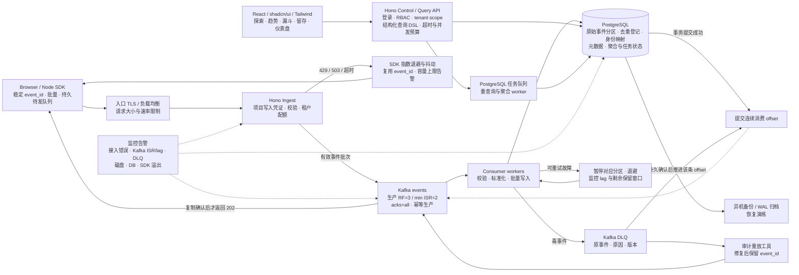

# 架构草案 v1（待确认）

图片预览见 [视觉草图](architecture-v1-visual-draft.png)，由内置 imagegen 根据 [提示词](architecture-image-prompt.txt) 生成。图片存在两处绘图偏差：202 返回线应从 Kafka 确认经 Ingest 返回 SDK，而不是从 Consumer 返回；Kafka 按用户键哈希分区，不按时间分区，时间分区属于 PostgreSQL。其余流程亦以本文 Mermaid 和文字为准，图片不得单独作为实施规格。

## 数据接入与分析流程

## 确认、重复与顺序

- HTTP 202 表示有效批次已被 Kafka 确认，不表示分析结果已更新。校验失败整批返回 400 并提供错误定位；鉴权失败 401/403；限流 429；持久接收无法确认返回 503 或超时。超时属于结果未知，使用相同 ID 重试。
- SDK 生成稳定 event_id；浏览器用 IndexedDB（受浏览器配额、清理、关闭时机限制），Node SDK 提供持久 outbox 适配器。仅内存或 sendBeacon 不构成持久送达保证。浏览器写入凭证可公开，仅允许写入，不能访问查询或管理 API。
- 全链路至少一次投递。PostgreSQL 同一事务内登记 UNIQUE(project_id,event_id) 去重键并写入原始事件，仅对新增事件产生聚合影响；成功提交数据库事务后才提交连续消费 offset。分区原始表的唯一约束必须包含分区键，因此跨分区去重依靠独立登记表，不能仅依赖分区表约束。
- 去重登记保留期至少覆盖所有允许重试/重放窗口；过期重放需走专门对账流程。原始事件、去重登记与聚合的删除/保留策略必须一致设计。
- 按 project_id + distinct_id 哈希分区，只有分区内有序；event_time 与 received_at 均保留，分析按事件时间处理迟到数据。身份合并与匿名转登录口径在 PRD 确定。
- DLQ 成功写入后才能越过毒事件；DLQ 不可用则暂停，不静默跳过。DLQ 有明确保留期与告警，重放保留事件 ID，避免重复计数。

## 降级顺序

| 故障 | 行为 | 边界 |
|---|---|---|
| 分析查询过载 | 限制并发/范围，重任务异步化；展示带时间戳的旧结果 | 优先保障接入与消费，读写资源需隔离预算 |
| PostgreSQL 不可用 | 消费暂停/退避，Kafka 缓冲，恢复后追赶 | Kafka 有限容量；预测耗尽前背压接入 |
| Kafka 不可用或 ISR 不足 | 返回 503，SDK 持久重试 | 不自动直写数据库，避免双链路一致性问题 |
| 租户超限 | 429 + Retry-After | 不使用默认采样或静默丢弃来伪装可靠性 |
| SDK 队列满/浏览器持久化失败 | 显式错误回调与可观测丢弃计数；由业务决定策略 | 不能保证从未持久送达的客户端事件不丢 |
| 接入或磁盘容量逼近上限 | 提前限流/拒绝，告警，保留已确认数据 | 本地无限 spool 不作为默认方案 |
| 整台单机损毁 | 从异机备份恢复 | 异步备份间隔内存在 RPO，不宣称零丢失 |

## 部署分层

单机试运行：一个入口、一个 Hono API、一个 worker、单节点 Kafka KRaft 与 PostgreSQL，Compose 分别设定资源限额，前端作为静态文件。Kafka RF=1 / min ISR=1，无副本高可用；所有服务在同机共享故障域。服务器过低时需缩减试验负载或增加资源，不能靠关闭 WAL/fsync 换取可靠性。

生产目标：接入实例水平扩展；Kafka 至少三个跨故障域 broker，生产 RF=3、min ISR=2、acks=all、关闭不洁 leader 选举，并验证所选 TypeScript 客户端的幂等配置；消费者按分区扩展；PostgreSQL 主备、连接池、异机备份与 WAL 归档。需要零已提交事务 RPO 时采用同步复制，并明确可用性代价。多副本不能替代备份，也不覆盖所有副本同时损毁。

Kafka 副本确认不等于每条消息在所有机器上完成同步磁盘刷写；共因掉电、存储故障仍需专门评估。可靠性承诺限定在验证过的故障模型、保留窗口和容量范围内。

初期 PostgreSQL 承担事务与分析：时间分区、有限索引、批量写入、增量聚合、查询超时与异步任务。任意高基数漏斗/留存的低延迟不能预先保证；压测后决定是否分离分析存储。Redis、ClickHouse、Kubernetes 不列为首期必需项。

## 核实依据

- [Kafka producer 配置：acks 与幂等](https://kafka.apache.org/40/configuration/producer-configs/)
- [Kafka broker 配置：min ISR](https://kafka.incubator.apache.org/34/configuration/broker-configs/)
- [PostgreSQL WAL 与可靠性](https://www.postgresql.org/docs/current/wal.html)

核实日期：2026-10-22。最终部署版本与 TypeScript 客户端仍需在工程阶段锁定并验证。
